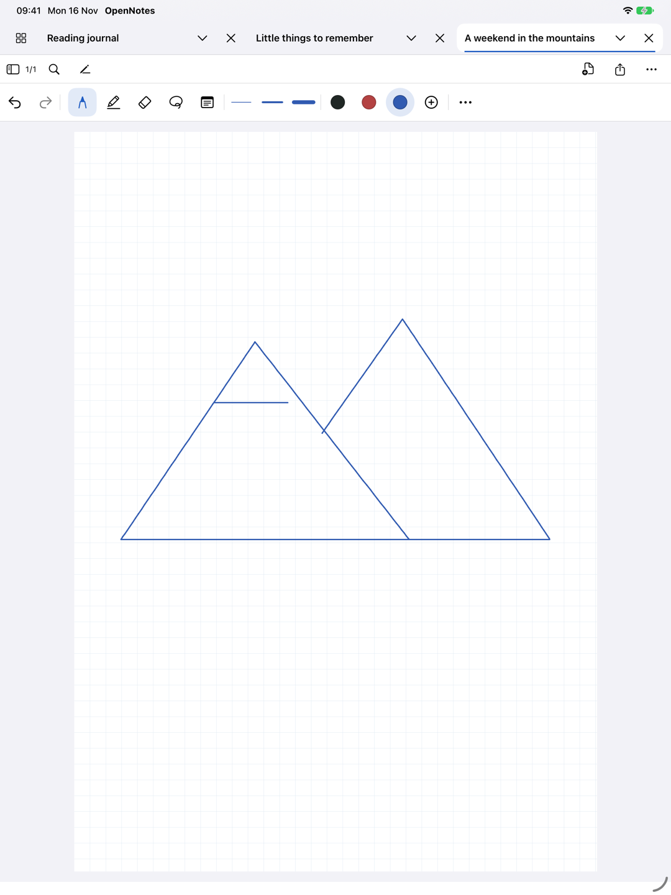
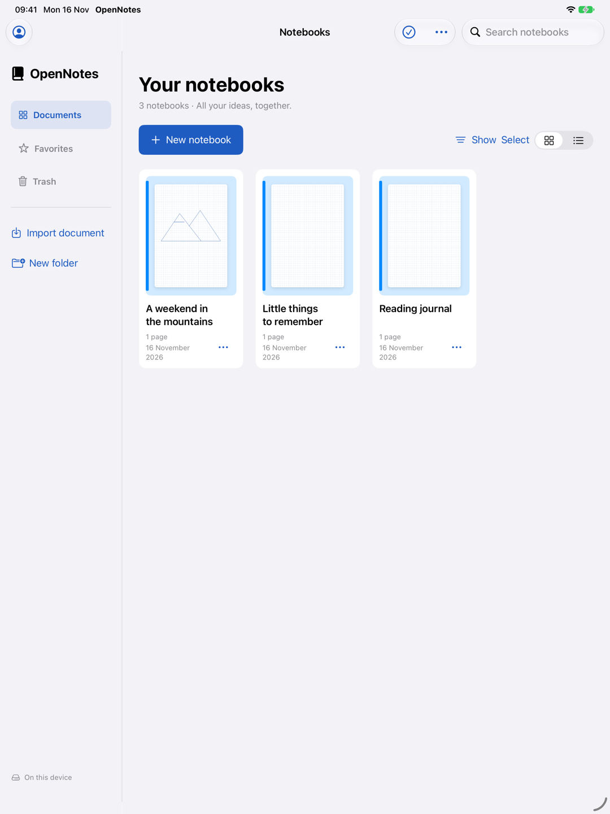
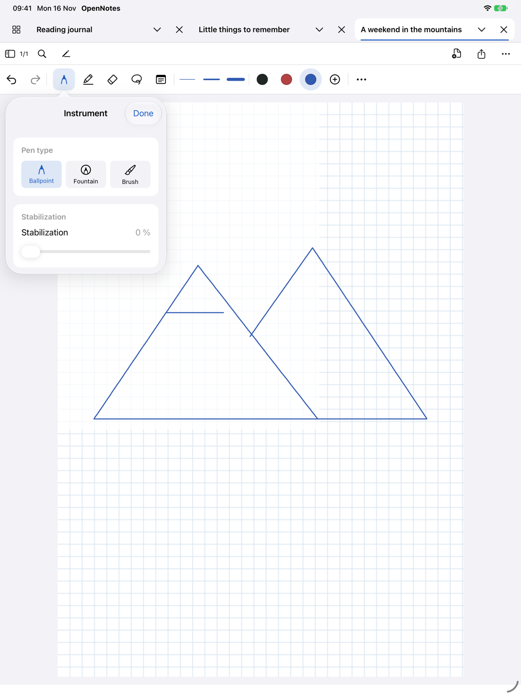
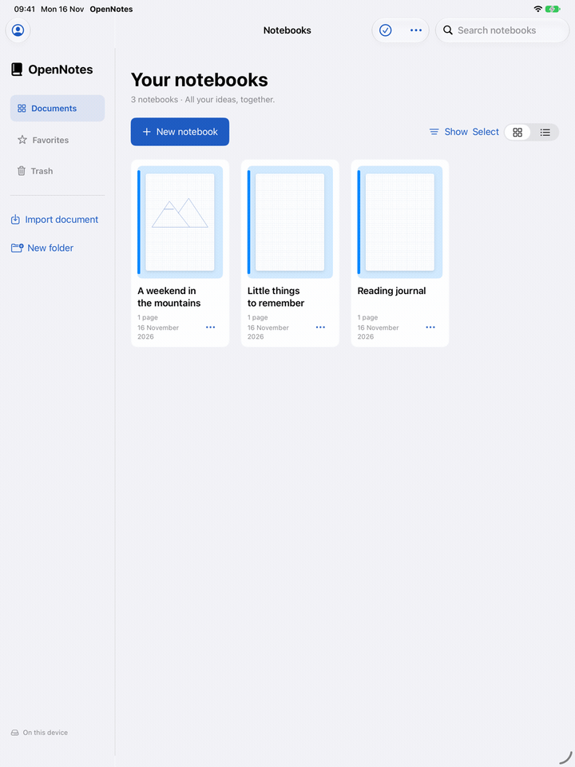

<p align="center">
  
</p>
<h1 align="center">OpenNotes</h1>
<p align="center"><strong>A little notebook. Room for every idea.</strong></p>
<p align="center">Handwriting, PDFs and everyday thoughts, together on iPad and iPhone.<br>Native Apple frameworks. Open source. Start without an account.</p>
<p align="center">
  <a href="https://edouaz.github.io/OpenNotes/">Explore the website</a> ·
  <a href="https://github.com/edouaz/OpenNotes/releases/tag/v0.1.0-prototype.36">Download build 36</a> ·
  <a href="https://edouaz.github.io/OpenNotes/develop.html">Installation</a> ·
  <a href="docs/README.md">Documentation</a>
</p>



## Your next page, close at hand

Write with a native ink engine, mark up a reading, or collect a few thoughts. OpenNotes keeps the tools near your page and your notebooks on your device.

- **Write your way.** Ballpoint, fountain and brush profiles, highlighter, colors, widths, stabilization and stroke patterns. Draw and hold to recognize shapes; scribble over ink to erase it.
- **Work with the whole page.** Precision, segment and whole-stroke erasing; lasso selection, movement, scaling and rotation; images, text and editable sticky notes.
- **Keep things together.** Folders, favorites, recoverable Trash and notebook tabs. Page thumbnails, bookmarks, paper templates and a persistent default page style.
- **Read and annotate.** Import PDFs, search their extracted text in a side panel, then export an annotated PDF.
- **Make it yours.** Move the toolbar, choose your writing preferences and use the battery saver in Settings.
- **Keep an editable copy.** Export a native `.opennote` archive. Legacy `.catnote` archives remain recognized; older PencilKit drawing data needs the original app to read it.

| A home for your notebooks | A pen that feels like yours |
| --- | --- |
|  |  |

<details>
<summary>A short tour of the app</summary>



This is a screenshot slideshow, not a measurement of drawing latency. [Capture details](docs/SCREENSHOTS.md).
</details>

## Try build 36

**0.1.0 · public preview · iOS / iPadOS 16+ · unsigned arm64 IPA.**

[Download the release](https://github.com/edouaz/OpenNotes/releases/tag/v0.1.0-prototype.36), or build from source below. The IPA requires your own signing and provisioning for the app and share extension. This is not an App Store or TestFlight download. [Installation guide](https://edouaz.github.io/OpenNotes/develop.html#install).

Back up valuable notes before upgrading. Keep the same signing team, bundle identifiers and App Group for an in-place update. Older PencilKit pages (including build 9) are unsupported by the native ink engine; export them from their original app first. [Compatibility and release notes](docs/RELEASE.md).

Local notebooks need no account. Optional Supabase synchronization and the MCP/CLI integration have their own setup and remain experimental. Physical Apple Pencil behavior, older hardware and full accessibility still need device validation.

## Run from source

You need macOS, Xcode and an installed iOS simulator. The iOS app uses system frameworks; no package installation or backend is needed for local use.

```sh
git clone https://github.com/edouaz/OpenNotes.git
cd OpenNotes
open OpenNotes.xcodeproj
```

Choose the **OpenNotes** scheme and an iPad or iPhone simulator, then Run. For a physical device, configure your signing team and matching App Group for both targets. [Developer guide](https://edouaz.github.io/OpenNotes/develop.html#development).

```sh
# After adding/removing Swift files or changing generated build settings:
python3 scripts/generate-project.py

# Choose an installed simulator from -showdestinations.
xcodebuild -project OpenNotes.xcodeproj -scheme OpenNotes \
  -destination 'platform=iOS Simulator,name=iPad Pro 13-inch (M5)' \
  -derivedDataPath build -only-testing:OpenNotesTests \
  CODE_SIGNING_ALLOWED=NO test

# Website checks, with no npm install:
node --test docs/tests/*.test.cjs
```

## Find your way around

| Path | What lives here |
| --- | --- |
| `OpenNotes/App/` | Library, workspace, settings and shared visual style |
| `OpenNotes/Core/` | Notebook models, page formats and tool settings |
| `OpenNotes/Editor/` | Native ink, rendering, gestures and editing |
| `OpenNotes/Services/` | Persistence, search, diagnostics and optional sync |
| `Shared/`, `ShareExtension/` | App Group import inbox and share extension |
| `OpenNotesTests/`, `OpenNotesUITests/` | Model, storage, geometry and interaction checks |
| `server/`, `supabase/` | Optional MCP server, CLI and database migrations |
| `Config/`, `scripts/` | Build configuration, project generation and IPA packaging |
| `docs/` | Website, guides, release notes and visual assets |

[Architecture](docs/ARCHITECTURE.md) · [Contributing](CONTRIBUTING.md) · [Security](SECURITY.md) · [Brand](docs/BRAND.md)

## License

MIT. Portions derived from [Signotes](https://github.com/SignoCreator/signotes) retain their original MIT notice. See [LICENSE](LICENSE) and [third-party notices](THIRD_PARTY_NOTICES.md).
